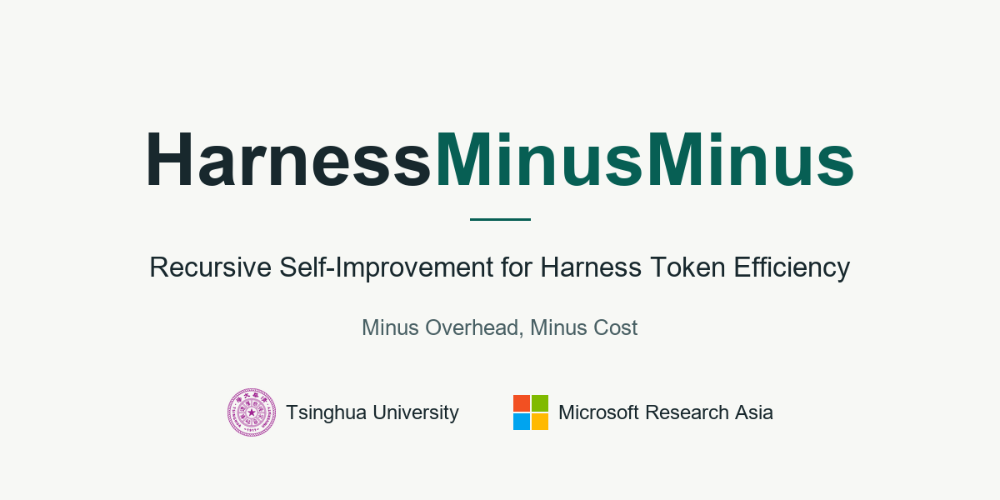
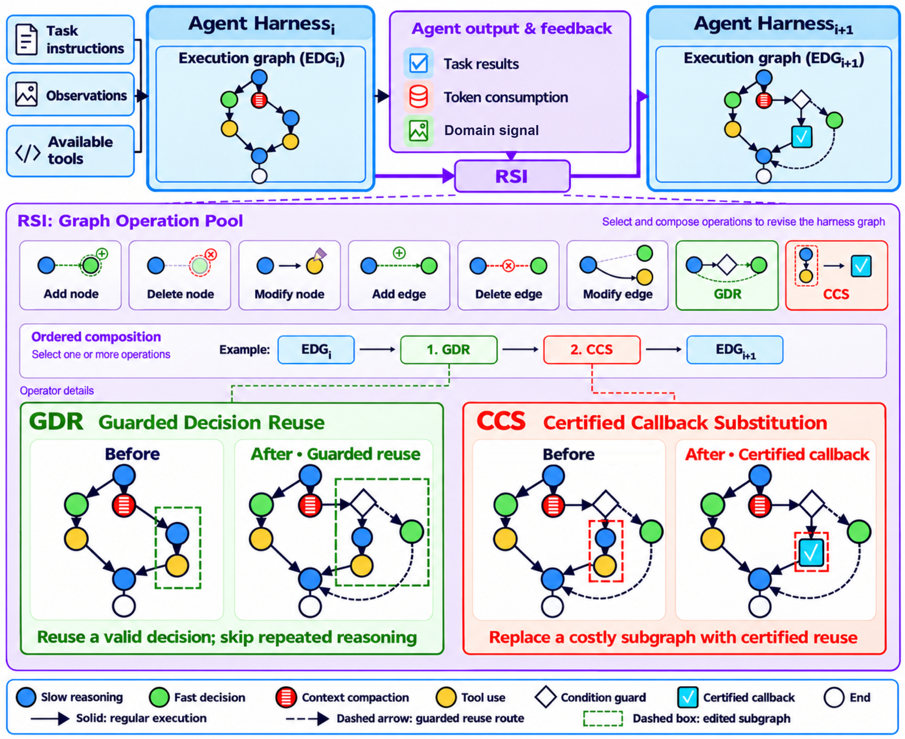
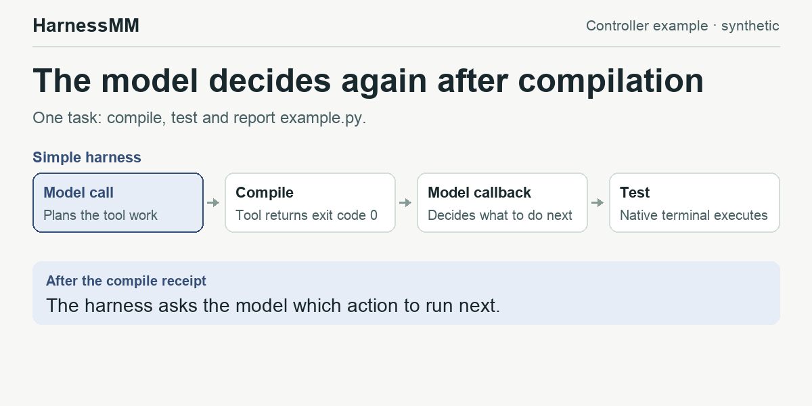
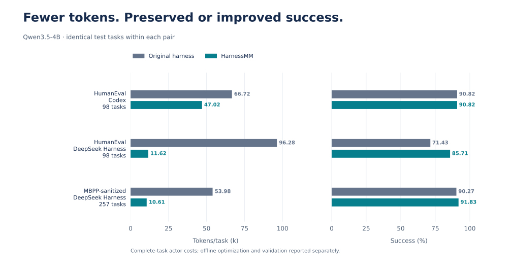

# HarnessMinusMinus: Recursive Self-Improvement for Harness Token Efficiency

<p align="center"><strong>Minus Overhead, Minus Cost</strong></p>

<p align="center">
  Yuhua Jiang<sup>1</sup>,
  Chang Xu<sup>2</sup>,
  Feifei Gao<sup>1</sup>,
  Li Zhao<sup>2</sup>
</p>
<p align="center">
  <sup>1</sup>Tsinghua University &nbsp; <sup>2</sup>Microsoft Research Asia
</p>

<p align="center">
  <a href="https://arxiv.org/abs/2610.32813"></a>
  <a href="https://arxiv.org/pdf/2610.32813"></a>
</p>

HarnessMinusMinus (HarnessMM) uses recursive self-improvement (RSI) to **reduce the tokens**
an agent harness needs for a target task or task family while
**preserving task performance**. It can **start from a simple harness** that calls
the model after every tool result, or **improve an existing harness such as Codex or DeepSeek Harness**.
The model weights stay fixed.

<p align="center">
  <picture>
    <source media="(prefers-reduced-motion: reduce)" srcset="docs/assets/readme/harnessmm-six-benchmark-results.png">
    
  </picture>
</p>

HarnessMM models the agent harness as an **Executable Decision Graph (EDG)**:
nodes represent operations such as model reasoning and tool calls, and directed
edges specify control flow and dependencies. RSI optimizes the graph by adding,
removing, or modifying nodes and edges. It also uses two specialized graph edits:
**Guarded Decision Reuse (GDR)** adds a path for a previously planned action
when its prerequisites and current-state checks pass; **Certified Callback
Substitution (CCS)** executes that action with its original arguments and
records the tool receipt and the model request it bypassed. This lets RSI
optimize what each step does and when it runs, using task success and total
token use on complete training runs to select changes to the harness as a whole.

The studies highlighted in this README span ten benchmarks: code generation and
terminal tasks (HumanEval, MBPP-sanitized, Terminal-Bench 2), question
answering (SearchQA), mathematical reasoning (LiveMath, AIME), interactive
tool use (ALFWorld, GAIA2), and web interaction (MiniWoB++, WebArena-Verified). On
HumanEval, Codex used **29.54% fewer execution tokens** at the same **90.82%**
success rate, while DeepSeek Harness used **87.93% fewer** and improved from
**71.43% to 85.71%** success. On GAIA2, HarnessMM cut execution tokens by
**12.41%** against the baseline harness and raised success from **42.71% to
43.96%**. On MiniWoB++, HarnessMM-V cut execution tokens by **29.56%** against
the baseline harness and raised success from **60.42% to 64.58%**. See the
[technical report](https://arxiv.org/html/2610.32813v2#S5.SS4) and
[MiniWoB++ comparison](#comparing-harnesses-on-web-tasks).

[Static overview](docs/assets/readme/guarded-reuse.png) · [Run the guarded-reuse example](examples/guarded_reuse.mjs) · [See the coding results](#optimizing-existing-coding-harnesses-codex-and-deepseek-harness) · [Try the pi extension](pi-harnessmm/)

## How it works



HarnessMM turns the harness into an editable execution graph and uses task feedback to find changes that save tokens while meeting the task-success target.

1. **Represent the harness as an Executable Decision Graph (EDG).** Each **node** is an operation the harness performs: constructing a prompt, compacting context, calling a model or a tool, or checking a condition. Directed **edges** encode two kinds of relationships: a control-flow edge says which node runs next; a prerequisite edge says which earlier operation must return a successful receipt before a dependent node can run.
2. **Compose edits from the graph operation pool.** RSI can combine basic edits with two specialized operators for decision reuse:
   - **Node edits:** add, delete, or modify an operation, such as changing a prompt or a tool call's arguments.
   - **Edge edits:** add, delete, or redirect a control-flow or prerequisite edge while preserving required dependencies.
   - **Guarded Decision Reuse (GDR):** add a guarded path for a previously planned action. The harness checks the prerequisite receipts and the current state; if no stored action qualifies, the model makes a fresh decision.
   - **Certified Callback Substitution (CCS):** replace an eligible model/tool pair with a native tool call that uses the stored arguments. Its certificate links the tool receipt to the ID of the model request that was skipped.
3. **Run the edited harness and compare.** RSI evaluates the candidate and the current version on the same training tasks. If the edit saves tokens over the whole task and meets the success target, the next round starts from the edited version; otherwise, it starts from the current one. Validation selects the rules to freeze for testing. On each new task, the harness uses those same rules to plan and check actions for that task. The model weights stay fixed.

### Example: compile, then test

In the animation below, the task is to compile and test `example.py`. A simple harness asks the model what to do after compilation. With HarnessMM, the model can specify the test command up front and make it conditional on a successful compile. GDR checks the compiler's exit code; if it is `0`, CCS runs the planned test directly. If compilation fails, the model decides how to proceed. The test still runs on the successful path; what disappears is the second model request.

<p align="center">
  <picture>
    <source media="(prefers-reduced-motion: reduce)" srcset="docs/assets/readme/overview.svg">
    
  </picture>
</p>

[Run the synthetic example](examples/guarded_reuse.mjs) · [See the code map](docs/CODE_MAP.md)

## Results

### Comparing harnesses on web tasks


| Method | Success (%) | Tokens/task (k) | HarnessMM-V token saving (%) |
| --- | ---: | ---: | ---: |
| **HarnessMM-V (ours)** | **64.58** | **3.98** | — |
| baseline harness | 60.42 | 5.65 | **29.56** |
| HarnessPro | 61.46 | 10.03 | **60.31** |
| SoL-Pi | 63.54 | 26.72 | **85.11** |
| Codex Harness | 63.54 | 39.53 | **89.93** |
| DeepSeek Harness | 61.46 | 20.03 | **80.14** |

Each harness uses Qwen3.5-9B, native screenshots, tools and scoring, with up to
15 actions and 180 seconds per episode. All methods receive the same objective:
reduce total input and output tokens per task while preserving performance.
The comparison counts every test call, including authorship, control, fallback,
compaction and unsuccessful executions. Offline learning, training checks and
validation are accounted for separately. HarnessPro uses a visual reproduction
of its Medium tier. See the [full ten-method comparison and results update](docs/VISUAL_COMPARISON.md).

### Optimizing existing coding harnesses: Codex and DeepSeek Harness

On HumanEval, HarnessMM cut execution tokens by **29.54% with Codex** at the same
success rate and by **87.93% with DeepSeek Harness** as success rose from 71.43%
to 85.71%. The DeepSeek Harness run used a self-hosted Qwen3.5-4B actor, a
structured `author_bank` adapter, guarded execution, public-history compaction
and metered finalization. The [SDK configuration](docs/DEEPSEEK_REPRODUCTION.md)
and [archived authoring adapter](reproduction/humaneval_v23/README.md) describe that run.

The three comparisons below use Qwen3.5-4B. Each arrow runs from the original
harness to its HarnessMM integration on the same test tasks, with the same
tools, scorer and token-efficiency objective.



| Benchmark | Tasks | Harness | Success (%) | Tokens/task (k) | Token saving (%) |
| --- | ---: | --- | ---: | ---: | ---: |
| HumanEval | 98 | Codex | 90.82 → 90.82 | 66.72 → 47.02 | 29.54 |
| HumanEval | 98 | DeepSeek Harness | 71.43 → 85.71 | 96.28 → 11.62 | 87.93 |
| MBPP-sanitized | 257 | DeepSeek Harness | 90.27 → 91.83 | 53.98 → 10.61 | 80.35 |

Costs include complete-task actor input and output, authorship, selectors,
finalization, retries, fallbacks and unsuccessful executions. Offline
optimization and validation costs are reported separately. See
[Section 5.3](https://arxiv.org/html/2610.32813v1#S5.SS3).

The MBPP-sanitized DeepSeek comparison can be recomputed from released
aggregates. The HumanEval comparisons require external evaluation and
metering evidence. See the [reproduction guide](REPRODUCE.md#readme-benchmark-results).

#### Decision reuse and callback substitution

On 257 MBPP-sanitized test tasks with DeepSeek Harness and Qwen3.5-4B,
retaining the decision graph across tool results reduced Tokens/task (k)
from **18.03 to 13.17** (**26.91% fewer**) compared with discarding the graph
after one use. Success was 93.00% with single-use graphs and 93.77% with
persistent graphs. The adjusted 98.33% paired interval for the reduction was 4.01% to
45.57%. The [ablation data and source records](docs/assets/readme/results.json)
give all four conditions and their certified substitutions.

## Quick start

Use Python 3.10–3.14 and Node.js 22 or later. The core Python package has no
third-party runtime dependencies. Node.js is also required by the Python
native-bank adapters.

```bash
git clone git@github.com:YuhuaJiang2002/HarnessMM.git
cd HarnessMM
python3 -m venv .venv
source .venv/bin/activate
python -m pip install -e '.[dev,analysis]'

node examples/guarded_reuse.mjs
python examples/partition.py
python -m pytest
node --test tests/*.test.mjs
```

Both examples use local fixtures. The guarded-reuse example runs three actions
through an in-memory dispatcher, prints a certificate for each substitution
and returns control to the model when the plan ends.

### Try it in pi

With pi installed, run this from the root of the cloned repository:

```bash
pi -e ./pi-harnessmm
```

The extension runs each planned terminal action when the preceding command’s result satisfies its guard. If the result is missing or a command fails, control returns to the model. See the [extension guide](pi-harnessmm/README.md) and [jlon’s upstream project](https://github.com/jlon/pi-harnessmm).

## Reproduction cases

The [reproduction index](reproduction/README.md) lists the MBPP aggregate replay
and the synthetic checks for HumanEval authoring, Codex native banks, GAIA2
continuations, the visual baseline and the desktop plugin. The offline runner
checks the four JSON cases and runs the desktop controller tests. See
[REPRODUCE.md](REPRODUCE.md) for the commands and their scope.

```bash
python reproduction/run_all.py
```

## Repository layout

| Path | Contents |
| --- | --- |
| `integrations/baseline_harness/` | Original screenshot-based decision boundary, literal action contract and baseline implementation index |
| `integrations/codex_harness/` | Public exports for the existing official CLI runtime, native MCP/terminal bank adapters and RSI lifecycle |
| `integrations/deepseek_harness/` | Native streaming bridge, action-bank contract, receipt guards, graph execution and certificates |
| [`pi-harnessmm/`](pi-harnessmm/) | Community pi extension by jlon, including its TypeScript source and tests |
| `harnessmm/harness/` | Codex adapters, protected training/selection lifecycle, benchmark-specific controllers and RSI |
| `harnessmm/learning/` | Residual fitting, cross-fitting, public-evidence contracts, routing and companion configuration methods |
| `harnessmm/evaluation/` | Native score checks, quality/cost comparisons and complete token accounting |
| `scripts/` | Research runners, preparation, metering and analysis dependencies |
| `configs/` | Two reference configurations used by the unit tests |
| `reproduction/` | Frozen HumanEval reference, MBPP result aggregates and runnable mechanism cases |
| `examples/` | Local examples requiring no provider credentials |
| `tests/` | Python and Node.js contract tests |
| `SOURCE_MANIFEST.json` | Original and published source hashes, including deployment-placeholder edits |

## Integrating a harness

The harness supplies the public state, original slow callback, unchanged native
tool dispatcher, metered provider access and native scorer. The controller
validates stored actions against the current tool schema, checks receipt guards
and either dispatches an eligible action or returns control to the slow actor.
It records the actual native receipt and the bypassed callback identifier.

Browse the [harness integrations](integrations/README.md), including
[Baseline harness](integrations/baseline_harness/README.md),
[Codex Harness](integrations/codex_harness/README.md) and DeepSeek Harness.
The baseline package makes a fresh model decision at each screenshot boundary;
the Codex package exports the existing native adapters without duplicating them.
Run `python examples/harness_boundaries.py` for a synthetic callback example.

Start with the [integration guide](docs/INTEGRATION.md). Python users can use
`NativeBankBoundary` for native MCP actions or `TerminalBankProvider` for a
Codex terminal boundary. The JavaScript integration exposes `ExecutableSubdag`
and `PersistentBank`. Choose the declared protocol version for the experiment;
different versions have different bank and selection contracts.

## Experiments and accounting

The research runners cover coding harnesses, ALFWorld, SearchQA, LiveMath,
AIME and GAIA2, with method-specific companion configurations. Their original
module names and protocol constants are retained. See
[reproduction and deployment](docs/REPRODUCIBILITY.md) before using them.

To run a benchmark, supply its upstream runtime, dataset and model endpoint.
Use the reference configs to choose the protocol, replace the deployment
placeholders and freeze the new configuration before launching the runner.

Give every arm the same objective of reducing complete-task input and output
tokens while preserving performance. Report `Tokens/task (k)` over all
executions to two decimal places. Count authorship, control, retries, fallbacks
and unsuccessful executions. For total RSI cost, add offline optimization
and selection to execution cost.

## License

The extracted project code retains its [Apache-2.0 license](LICENSE).
Upstream harnesses, benchmarks, datasets and model weights retain their own
licenses and access requirements. See [NOTICE](NOTICE).

## Contributing

This project welcomes contributions and suggestions.  Most contributions require you to agree to a
Contributor License Agreement (CLA) declaring that you have the right to, and actually do, grant us
the rights to use your contribution. For details, visit [Contributor License Agreements](https://cla.opensource.microsoft.com).

When you submit a pull request, a CLA bot will automatically determine whether you need to provide
a CLA and decorate the PR appropriately (e.g., status check, comment). Simply follow the instructions
provided by the bot. You will only need to do this once across all repos using our CLA.

This project has adopted the [Microsoft Open Source Code of Conduct](https://opensource.microsoft.com/codeofconduct/).
For more information see the [Code of Conduct FAQ](https://opensource.microsoft.com/codeofconduct/faq/) or
contact [opencode@microsoft.com](mailto:opencode@microsoft.com) with any additional questions or comments.

## Trademarks

This project may contain trademarks or logos for projects, products, or services. Authorized use of Microsoft
trademarks or logos is subject to and must follow
[Microsoft's Trademark & Brand Guidelines](https://www.microsoft.com/legal/intellectualproperty/trademarks/usage/general).
Use of Microsoft trademarks or logos in modified versions of this project must not cause confusion or imply Microsoft sponsorship.
Any use of third-party trademarks or logos are subject to those third-party's policies.

## Citation

If you use this implementation, cite **HarnessMM: Recursive Self-Improvement
for Harness Token Efficiency**, by Yuhua Jiang, Chang Xu, Feifei Gao and Li Zhao
([arXiv:2610.32813](https://arxiv.org/abs/2610.32813)).

```bibtex
@misc{jiang2026harnessmmrecursiveselfimprovementharness,
  title={HarnessMM: Recursive Self-Improvement for Harness Token Efficiency},
  author={Yuhua Jiang and Chang Xu and Feifei Gao and Li Zhao},
  year={2026},
  eprint={2610.32813},
  archivePrefix={arXiv},
  primaryClass={cs.AI},
  url={https://arxiv.org/abs/2610.32813},
}
```

The BibTeX citation is provided in [CITATION.bib](CITATION.bib).
