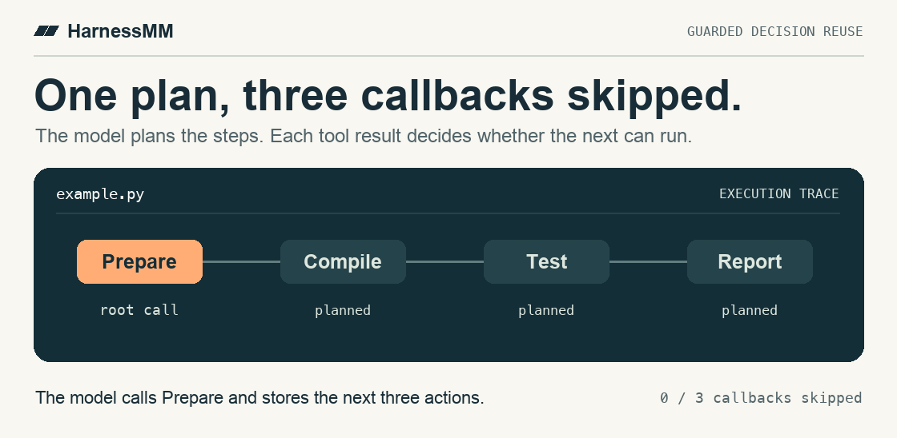
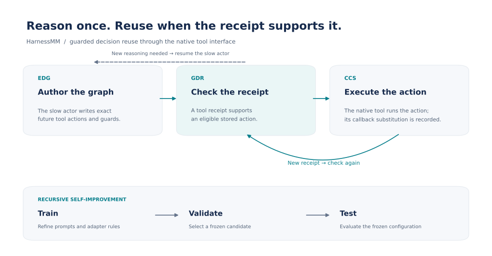
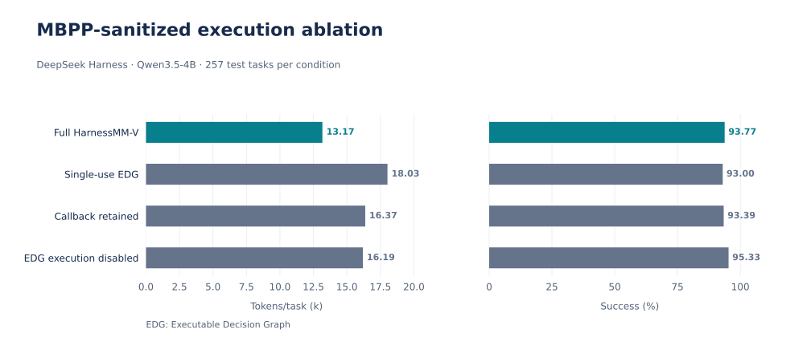

# HarnessMM

**Recursive Self-Improvement for Harness Token Efficiency**

<p align="center">
  <a href="https://arxiv.org/abs/2610.32813"></a>
  <a href="https://arxiv.org/pdf/2610.32813"></a>
</p>

<p align="center">
  <picture>
    <source media="(prefers-reduced-motion: reduce)" srcset="docs/assets/readme/guarded-reuse.png">
    
  </picture>
</p>

[Run the guarded-reuse example](examples/guarded_reuse.mjs) · [See the coding results](#codex-and-deepseek-coding-harnesses) · [Try the pi extension](pi-harnessmm/)

HarnessMM lets an agent plan several tool calls in one model turn. After each
call, the harness reads the tool result and runs the next planned action when
its conditions hold. On HumanEval, Codex with HarnessMM used 29.54% fewer
execution tokens at the same 90.82% success rate.

HarnessMM-V extends this approach to visual tasks. On 96 MiniWoB++ test tasks,
it solved 60 tasks and used fewer execution tokens than each of the four
harnesses below.

## HarnessPro, SoL-Pi, Codex and DeepSeek comparisons


| Method | Success (%) | Tokens/task (k) | HarnessMM-V token saving (%) |
| --- | ---: | ---: | ---: |
| **HarnessMM-V (ours)** | **62.50** | **5.07** | — |
| HarnessPro | 61.46 | 10.03 | **49.42** |
| SoL-Pi | 60.42 | 41.99 | **87.92** |
| Codex Harness | 59.38 | 44.77 | **88.67** |
| DeepSeek Harness | 61.46 | 20.03 | **74.69** |

Each harness uses Qwen3.5-9B, native screenshots, tools and scoring, with up to
15 actions and 180 seconds per episode. All methods receive the same objective:
reduce total input and output tokens per task while preserving performance.
The comparison counts every test call, including authorship, control, fallback,
compaction and unsuccessful executions. Offline learning, training checks and
validation are accounted for separately. HarnessPro uses a visual reproduction
of its Medium tier. The [full comparison](docs/VISUAL_COMPARISON.md) covers ten methods.

## How it works


*Figure 1. HarnessMM uses task feedback to improve execution graphs, reuse resolved decisions and replace redundant reasoning callbacks with certified native execution.*



HarnessMM (Harness Minus Minus) reuses decisions that an agent has already made.
A slow model call writes exact future tool actions into an Executable Decision
Graph (EDG). After each tool result, Guarded Decision Reuse (GDR) checks whether
the observed receipt supports a stored action. Certified Callback Substitution
(CCS) sends that action through the native tool interface and records the
reasoning callback it replaced. The original actor resumes when new reasoning
is needed.

Recursive self-improvement (RSI) refines companion prompts, context settings and
adapter rules using training feedback. Validation selects among frozen
training-derived candidates; the selected configuration is frozen before test.
Model weights stay fixed.

This repository contains the current implementation extracted from the
[PhiAgent research workspace](https://github.com/YuhuaJiang2002/PhiAgent).
The Python package is `harnessmm`, matching the project name:

```python
from harnessmm.harness.codex_chisel import CodexChiselController
from harnessmm.harness.benchmark_partition import build_partition
```

Existing `phiagent` imports remain supported through a compatibility bridge.
`CHISEL`, `SAR`, `Jev` and `<CHISEL_PLAN>` retain their internal implementation
and protocol names. See [package migration](docs/PACKAGE_MIGRATION.md) for details.
See the [code map](docs/CODE_MAP.md) for the paper-to-code correspondence.

## Codex and DeepSeek coding harnesses

On HumanEval, HarnessMM cut execution tokens by **29.54% with Codex** at the same
success rate and by **87.93% with DeepSeek Harness** as success rose from 71.43%
to 85.71%. The DeepSeek Harness run used a self-hosted Qwen3.5-4B actor, a
structured `author_bank` adapter, guarded execution, public-history compaction
and metered finalization. The [SDK configuration](docs/DEEPSEEK_REPRODUCTION.md)
and [archived authoring adapter](reproduction/humaneval_v23/README.md) describe that run.

Each arrow runs from the original harness to HarnessMM. Both use the same test
tasks, backbone, tools, scorer and token-efficiency objective.


| Benchmark | Tasks | Harness | Success (%) | Tokens/task (k) | Token saving (%) |
| --- | ---: | --- | ---: | ---: | ---: |
| HumanEval | 98 | Codex | 90.82 → 90.82 | 66.72 → 47.02 | 29.54 |
| HumanEval | 98 | DeepSeek Harness | 71.43 → 85.71 | 96.28 → 11.62 | 87.93 |
| MBPP-sanitized | 257 | DeepSeek Harness (Qwen) | 90.27 → 91.83 | 53.98 → 10.61 | 80.35 |

Costs include complete-task actor input and output, authorship, selectors,
finalization, retries, fallbacks and unsuccessful executions. Offline
optimization and validation costs are reported separately. See
[Section 5.3](https://arxiv.org/html/2610.32813v1#S5.SS3).

The MBPP-sanitized row can be recomputed from released aggregates. Both HumanEval
rows require external evaluation and metering evidence. See the [README result
map](REPRODUCE.md#readme-benchmark-results) for commands and runner links.

### Decision reuse and callback substitution

A separate MBPP-sanitized ablation uses the same 257 test tasks and execution
settings across conditions:



| Configuration | Success (%) | Tokens/task (k) |
| --- | ---: | ---: |
| HarnessMM | 93.77 | 13.17 |
| W/o GDR (single-use EDG) | 93.00 | 18.03 |
| W/o CCS (callbacks retained) | 93.39 | 16.37 |

HarnessMM uses **26.91% fewer tokens than single-use graphs** and **19.52%
fewer than retained callbacks**, with 407 certified callback substitutions.
See [Section 5.5](https://arxiv.org/html/2610.32813v1#S5.SS5) for the complete
ablation and paired uncertainty.

## Quick start

Use Python 3.10–3.14 and Node.js 22 or later. The core Python package has no
third-party runtime dependencies. Node.js is also required by the Python
native-bank adapters.

```bash
git clone git@github.com:YuhuaJiang2002/HarnessMM.git
cd HarnessMM
python3 -m venv .venv
source .venv/bin/activate
python -m pip install -e '.[dev,analysis]'

node examples/guarded_reuse.mjs
python examples/partition.py
python -m pytest
node --test tests/*.test.mjs
```

Both examples use local fixtures. The guarded-reuse example runs three actions
through an in-memory dispatcher, prints a certificate for each substitution
and returns control to the model when the plan ends.

### Try it in pi

With pi installed, run this from the root of the cloned repository:

```bash
pi -e ./pi-harnessmm
```

The extension runs each planned terminal action when the preceding command’s result satisfies its guard. If the result is missing or a command fails, control returns to the model. See the [extension guide](pi-harnessmm/README.md) and [jlon’s upstream project](https://github.com/jlon/pi-harnessmm).

## Reproduction cases

The [reproduction index](reproduction/README.md) lists the MBPP aggregate replay
and the synthetic checks for HumanEval authoring, Codex native banks, GAIA2
continuations, the visual baseline and the desktop plugin. The offline runner
checks the four JSON cases and runs the desktop controller tests. See
[REPRODUCE.md](REPRODUCE.md) for the commands and their scope.

```bash
python reproduction/run_all.py
```

## Repository layout

| Path | Contents |
| --- | --- |
| `integrations/baseline_harness/` | Original screenshot-based decision boundary, literal action contract and baseline implementation index |
| `integrations/codex_harness/` | Public exports for the existing official CLI runtime, native MCP/terminal bank adapters and RSI lifecycle |
| `integrations/deepseek_harness/` | Native streaming bridge, action-bank contract, receipt guards, graph execution and certificates |
| [`pi-harnessmm/`](pi-harnessmm/) | Community pi extension by jlon, including its TypeScript source and tests |
| `harnessmm/harness/` | Codex adapters, protected training/selection lifecycle, benchmark-specific controllers and RSI |
| `harnessmm/learning/` | Residual fitting, cross-fitting, public-evidence contracts, routing and companion configuration methods |
| `harnessmm/evaluation/` | Native score checks, quality/cost comparisons and complete token accounting |
| `phiagent/` | Compatibility bridge for older Python imports |
| `scripts/` | Research runners, preparation, metering and analysis dependencies |
| `configs/` | Two reference configurations used by the unit tests |
| `reproduction/` | Frozen HumanEval reference, MBPP result aggregates and runnable mechanism cases |
| `examples/` | Local examples requiring no provider credentials |
| `tests/` | Python and Node.js contract tests |
| `SOURCE_MANIFEST.json` | Original and published source hashes, including deployment-placeholder edits |

## Integrating a harness

The harness supplies the public state, original slow callback, unchanged native
tool dispatcher, metered provider access and native scorer. The controller
validates stored actions against the current tool schema, checks receipt guards
and either dispatches an eligible action or returns control to the slow actor.
It records the actual native receipt and the bypassed callback identifier.

Browse the [harness integrations](integrations/README.md), including
[Baseline harness](integrations/baseline_harness/README.md),
[Codex Harness](integrations/codex_harness/README.md) and DeepSeek Harness.
The baseline package makes a fresh model decision at each screenshot boundary;
the Codex package exports the existing native adapters without duplicating them.
Run `python examples/harness_boundaries.py` for a synthetic callback example.

Start with the [integration guide](docs/INTEGRATION.md). Python users can use
`NativeBankBoundary` for native MCP actions or `TerminalBankProvider` for a
Codex terminal boundary. The JavaScript integration exposes `ExecutableSubdag`
and `PersistentBank`. Choose the declared protocol version for the experiment;
different versions have different bank and selection contracts.

## Experiments and accounting

The research runners cover coding harnesses, ALFWorld, SearchQA, LiveMath,
AIME and GAIA2, with method-specific companion configurations. Their original
module names and protocol constants are retained. See
[reproduction and deployment](docs/REPRODUCIBILITY.md) before using them.

To run a benchmark, supply its upstream runtime, dataset and model endpoint.
Use the reference configs to choose the protocol, replace the deployment
placeholders and freeze the new configuration before launching the runner.

Give every arm the same objective of reducing complete-task input and output
tokens while preserving performance. Report `Tokens/task (k)` over all
executions to two decimal places. Count authorship, control, retries, fallbacks
and unsuccessful executions. For total RSI cost, add offline optimization
and selection to execution cost.

## Citation

If you use this implementation, cite **HarnessMM: Recursive Self-Improvement
for Harness Token Efficiency**, by Yuhua Jiang, Chang Xu, Feifei Gao and Li Zhao
([arXiv:2610.32813](https://arxiv.org/abs/2610.32813)).

```bibtex
@misc{jiang2026harnessmmrecursiveselfimprovementharness,
  title={HarnessMM: Recursive Self-Improvement for Harness Token Efficiency},
  author={Yuhua Jiang and Chang Xu and Feifei Gao and Li Zhao},
  year={2026},
  eprint={2610.32813},
  archivePrefix={arXiv},
  primaryClass={cs.AI},
  url={https://arxiv.org/abs/2610.32813},
}
```

The BibTeX citation is provided in [CITATION.bib](CITATION.bib).

## License

The extracted project code retains its [Apache-2.0 license](LICENSE).
Upstream harnesses, benchmarks, datasets and model weights retain their own
licenses and access requirements. See [NOTICE](NOTICE).
