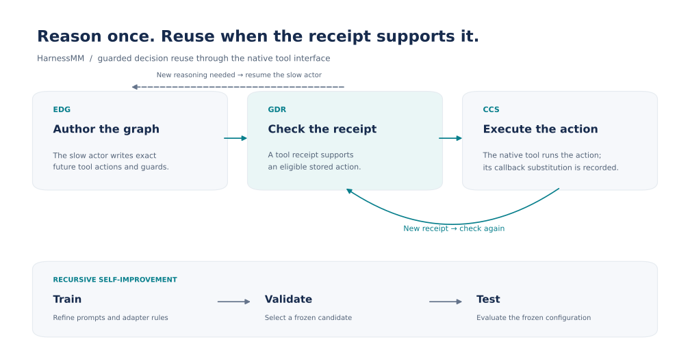
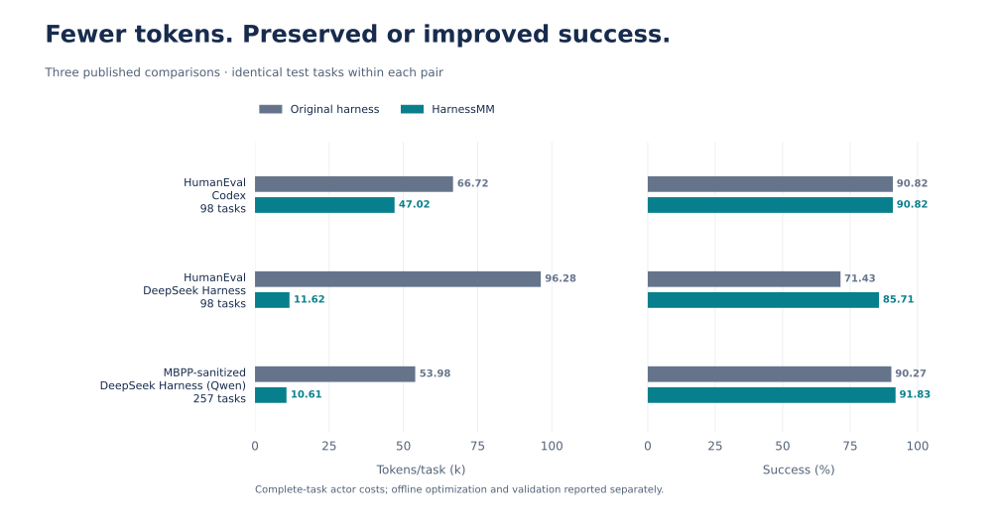
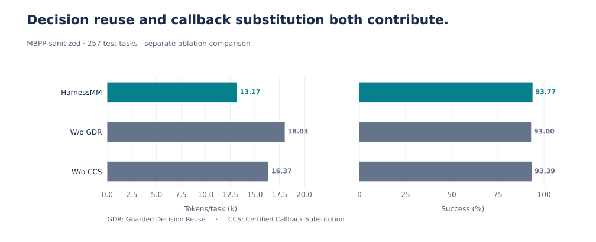

# HarnessMM

**Recursive Self-Improvement for Harness Token Efficiency**

<p align="center">
  <a href="https://arxiv.org/abs/2610.32813"></a>
  <a href="https://arxiv.org/pdf/2610.32813"></a>
</p>

HarnessMM reduces harness token consumption through guarded decision reuse.
Its visual extension, **HarnessMM-V**, achieves **higher success and lower
execution cost than HarnessPro, SoL-Pi, Codex Harness and DeepSeek Harness**
on the same 96 MiniWoB++ test tasks. The coding results below also show lower
cost with preserved or improved success for Codex and DeepSeek Harness.

## HarnessPro, SoL-Pi, Codex and DeepSeek comparisons


| Method | Success (%) | Tokens/task (k) | HarnessMM-V token saving (%) |
| --- | ---: | ---: | ---: |
| **HarnessMM-V (ours)** | **62.50** | **5.07** | — |
| HarnessPro | 61.46 | 10.03 | **49.42** |
| SoL-Pi | 60.42 | 41.99 | **87.92** |
| Codex Harness | 59.38 | 44.77 | **88.67** |
| DeepSeek Harness | 61.46 | 20.03 | **74.69** |

These additional visual-extension experiments use Qwen3.5-9B, the same full
test population, native screenshots, tools and scorer, a 15-action limit and
a 180-second episode allowance. All methods receive the objective of reducing
complete-task input-plus-output tokens while preserving performance. Costs
include every test execution call, including authorship, control, fallback,
compaction and unsuccessful executions; offline learning and training/validation
verification are separate. HarnessPro uses a configured visual reproduction of
its Medium tier. See the [protocol and full comparison](docs/VISUAL_COMPARISON.md)
for all ten methods, runtime details and cost definitions. These are
HarnessMM-V results, separate from the HarnessMM coding experiments in the
linked paper.

## How it works



HarnessMM (Harness Minus Minus) reuses decisions that an agent has already made.
A slow model call writes exact future tool actions into an Executable Decision
Graph (EDG). After each tool result, Guarded Decision Reuse (GDR) checks whether
the observed receipt supports a stored action. Certified Callback Substitution
(CCS) sends that action through the native tool interface and records the
reasoning callback it replaced. The original actor resumes when new reasoning
is needed.

Recursive self-improvement (RSI) refines companion prompts, context settings and
adapter rules using training feedback. Validation selects among frozen
training-derived candidates; the selected configuration is frozen before test.
Model weights stay fixed.

This repository contains the current implementation extracted from the
[PhiAgent research workspace](https://github.com/YuhuaJiang2002/PhiAgent).
Existing Python imports use `phiagent`; `CHISEL`, `SAR`, `Jev` and
`<CHISEL_PLAN>` remain internal implementation and protocol names. They are
retained so existing controllers, configurations and tests continue to work.
See the [code map](docs/CODE_MAP.md) for the paper-to-code correspondence.

## Codex and DeepSeek coding harnesses

On HumanEval, HarnessMM uses **29.54% fewer tokens with Codex** at the same
90.82% success, and **87.93% fewer tokens with DeepSeek Harness** while raising
success from 71.43% to 85.71%. On MBPP-sanitized, it uses **80.35% fewer tokens
with DeepSeek Harness (Qwen)** while raising success from 90.27% to 91.83%.

HarnessMM reduces token consumption while preserving or improving coding
success in these published comparisons. Values show the original harness →
HarnessMM on the same test tasks. Each pair shares its backbone, tools and
scorer. All arms receive prompts to reduce complete-task input-plus-output
tokens while preserving performance.



| Benchmark | Tasks | Harness | Success (%) | Tokens/task (k) | Token saving (%) |
| --- | ---: | --- | ---: | ---: | ---: |
| HumanEval | 98 | Codex | 90.82 → 90.82 | 66.72 → 47.02 | 29.54 |
| HumanEval | 98 | DeepSeek Harness | 71.43 → 85.71 | 96.28 → 11.62 | 87.93 |
| MBPP-sanitized | 257 | DeepSeek Harness (Qwen) | 90.27 → 91.83 | 53.98 → 10.61 | 80.35 |

Costs include complete-task actor input and output, authorship, selectors,
finalization, retries, fallbacks and unsuccessful executions. Offline
optimization and validation costs are reported separately. See
[Section 5.3](https://arxiv.org/html/2610.32813v1#S5.SS3).

### Decision reuse and callback substitution

A separate MBPP-sanitized ablation uses the same 257 test tasks and execution
settings across conditions:



| Configuration | Success (%) | Tokens/task (k) |
| --- | ---: | ---: |
| HarnessMM | 93.77 | 13.17 |
| W/o GDR (single-use EDG) | 93.00 | 18.03 |
| W/o CCS (callbacks retained) | 93.39 | 16.37 |

HarnessMM uses **26.91% fewer tokens than single-use graphs** and **19.52%
fewer than retained callbacks**, with 407 certified callback substitutions.
See [Section 5.5](https://arxiv.org/html/2610.32813v1#S5.SS5) for the complete
ablation and paired uncertainty.

## Quick start

Use Python 3.10–3.14 and Node.js 22 or later. The core Python package has no
third-party runtime dependencies. Node.js is also required by the Python
native-bank adapters.

```bash
git clone git@github.com:YuhuaJiang2002/HarnessMM.git
cd HarnessMM
python3 -m venv .venv
source .venv/bin/activate
python -m pip install -e '.[dev,analysis]'

node examples/guarded_reuse.mjs
python examples/partition.py
python -m pytest
node --test tests/*.test.mjs
```

Both examples run locally with synthetic inputs and make no model calls.
The guarded-reuse example executes three receipt-supported actions through an
in-memory native dispatcher and prints their substitution certificates. It
also demonstrates a return to the slow actor after the graph is exhausted.
These examples demonstrate controller behavior; they are not benchmark scores
or token-saving measurements.

## Repository layout

| Path | Contents |
| --- | --- |
| `integrations/deepseek_harness/` | Native streaming bridge, action-bank contract, receipt guards, graph execution and certificates |
| `phiagent/harness/` | Codex adapters, protected training/selection lifecycle, benchmark-specific controllers and RSI |
| `phiagent/learning/` | Residual fitting, cross-fitting, public-evidence contracts, routing and companion configuration methods |
| `phiagent/evaluation/` | Native score checks, quality/cost comparisons and complete token accounting |
| `scripts/` | Research runners, preparation, metering and analysis dependencies |
| `configs/` | Two reference configurations used by the unit tests |
| `examples/` | Local examples requiring no provider credentials |
| `tests/` | Python and Node.js contract tests |
| `SOURCE_MANIFEST.json` | Original and published source hashes, including deployment-placeholder edits |

## Integrating a harness

The harness supplies the public state, original slow callback, unchanged native
tool dispatcher, metered provider access and native scorer. The controller
validates stored actions against the current tool schema, checks receipt guards
and either dispatches an eligible action or returns control to the slow actor.
It records the actual native receipt and the bypassed callback identifier.

Start with the [integration guide](docs/INTEGRATION.md). Python users can use
`NativeBankBoundary` for native MCP actions or `TerminalBankProvider` for a
Codex terminal boundary. The JavaScript integration exposes `ExecutableSubdag`
and `PersistentBank`. Choose the declared protocol version for the experiment;
different versions have different bank and selection contracts.

## Experiments and accounting

The research runners cover coding harnesses, ALFWorld, SearchQA, LiveMath,
AIME and GAIA2, with method-specific companion configurations. Their original
module names and protocol constants are retained. See
[reproduction and deployment](docs/REPRODUCIBILITY.md) before using them.

Benchmark execution requires the corresponding upstream runtime, datasets,
model access and a new experiment configuration. Several runners retain
deployment admission checks and source seals. Machine-specific paths and
worker hostnames have been replaced by explicit placeholders. The reference
configs describe historical protocols; they are not ready-to-launch jobs.
Datasets, model weights, provider credentials and paid execution records are
managed separately.

Every comparison arm should receive the shared objective of reducing
complete-task input-plus-output token use while preserving task performance.
Costs include authorship, optimization, selection, control, retries, fallbacks
and unsuccessful executions within the declared scope. Report
`Tokens/task (k)` over the complete declared execution population, with two
decimal places. Execution savings and all-in RSI savings require separate
accounting; the former alone does not establish the latter.

## Citation

If you use this implementation, cite **HarnessMM: Recursive Self-Improvement
for Harness Token Efficiency**, by Yuhua Jiang, Chang Xu, Feifei Gao and Li Zhao
([arXiv:2610.32813](http://arxiv.org/abs/2610.32813)).

```bibtex
@misc{jiang2026harnessmmrecursiveselfimprovementharness,
  title={HarnessMM: Recursive Self-Improvement for Harness Token Efficiency},
  author={Yuhua Jiang and Chang Xu and Feifei Gao and Li Zhao},
  year={2026},
  eprint={2610.32813},
  archivePrefix={arXiv},
  primaryClass={cs.AI},
  url={https://arxiv.org/abs/2610.32813},
}
```

Repository citation metadata is provided in [CITATION.cff](CITATION.cff).

## License

The extracted project code retains its [Apache-2.0 license](LICENSE).
Upstream harnesses, benchmarks, datasets and model weights retain their own
licenses and access requirements. See [NOTICE](NOTICE).
