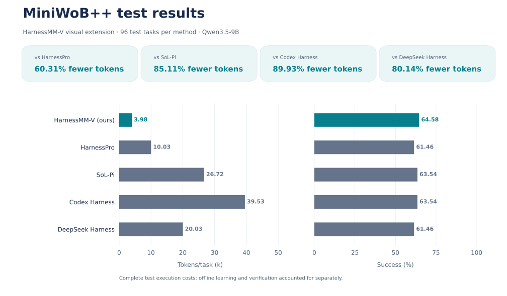
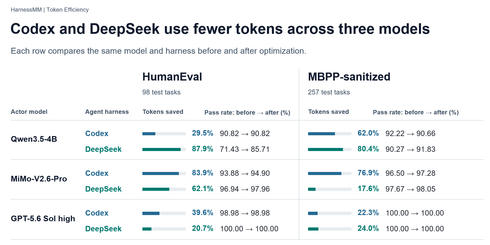

# HarnessMinusMinus (HarnessMM)

**Recursive Self-Improvement for Harness Token Efficiency**

Yuhua Jiang<sup>1</sup>, Chang Xu<sup>2</sup>, Feifei Gao<sup>1</sup>, Li Zhao<sup>2</sup>

<sup>1</sup>Tsinghua University · <sup>2</sup>Microsoft Research Asia

<p align="center">
  <a href="https://arxiv.org/abs/2610.32813"></a>
  <a href="https://arxiv.org/pdf/2610.32813"></a>
</p>

HarnessMinusMinus (HarnessMM) uses recursive self-improvement (RSI) to tune
an agent harness for a target task or task family. The goal is to use fewer
tokens while preserving task performance. HarnessMM can start with a simple
harness that calls the model after each tool result or optimize an existing
harness such as Codex or DeepSeek Harness. The model weights stay fixed.

HarnessMM represents execution as an **Executable Decision Graph (EDG)**.
Nodes represent steps such as reasoning and tool calls. Directed edges
specify which steps can follow and which must finish first. A stored tool
action carries its exact arguments and a guard. **Guarded Decision Reuse
(GDR)** opens a path to that action when the tool receipt satisfies the
guard. **Certified Callback Substitution (CCS)** runs it through the native
tool interface and records the receipt and the model callback it replaces.
Control returns to the model when the next step requires a new decision.

RSI uses task outcomes and token counts from training runs to decide where
to add, remove or edit graph nodes and edges. It also revises the prompts and
rules that govern graph authoring and execution. Each accepted configuration
seeds the next round, and validation selects the configuration for held-out
evaluation.

The studies summarized here cover **10 benchmarks across five task areas**.
HumanEval, MBPP-sanitized and Terminal-Bench 2 cover coding and terminal work.
SearchQA covers question answering, and LiveMath and AIME cover mathematical
reasoning. ALFWorld and GAIA2 test interactive tool use. MiniWoB++ and
WebArena-Verified test web interaction.

On HumanEval, adding HarnessMM reduced execution tokens by **29.54% for
Codex** at the same 90.82% success rate and by **87.93% for DeepSeek Harness**
as success rose from 71.43% to 85.71%. On 480 GAIA2 test scenarios, HarnessMM
used **12.41% fewer actor tokens** than the baseline harness and raised
success from 42.71% to 43.96%. On 96 MiniWoB++ test tasks, HarnessMM-V used
**29.56% fewer execution tokens** than the baseline harness and raised success
from 60.42% to 64.58%.
[Technical report](https://arxiv.org/html/2610.32813v2#S5) · [MiniWoB++ comparison](#harnesspro-sol-pi-codex-and-deepseek-comparisons)

<p align="center">
  <picture>
    <source media="(prefers-reduced-motion: reduce)" srcset="docs/assets/readme/guarded-reuse.png">
    
  </picture>
</p>

[Static overview](docs/assets/readme/guarded-reuse.png) · [Run the guarded-reuse example](examples/guarded_reuse.mjs) · [See the coding results](#codex-and-deepseek-coding-harnesses) · [Try the pi extension](pi-harnessmm/)

[HarnessMM-R](harnessMM-R/) generates robot demonstrations in MuJoCo. For tabletop sorting, run the offline expert on a CPU or let Qwen3.8-27B plan pick-and-place actions on an H200. The [ARX X5 generator and four-view demo](harnessMM-R/#arx-x5-pcb-assembly) cover dual-arm PCB assembly.

## HarnessPro, SoL-Pi, Codex and DeepSeek comparisons



| Method | Success (%) | Tokens/task (k) | HarnessMM-V token saving (%) |
| --- | ---: | ---: | ---: |
| **HarnessMM-V (ours)** | **64.58** | **3.98** | — |
| baseline harness | 60.42 | 5.65 | **29.56** |
| HarnessPro | 61.46 | 10.03 | **60.31** |
| SoL-Pi | 63.54 | 26.72 | **85.11** |
| Codex Harness | 63.54 | 39.53 | **89.93** |
| DeepSeek Harness | 61.46 | 20.03 | **80.14** |

Each harness uses Qwen3.5-9B, native screenshots, tools and scoring, with up to
15 actions and 180 seconds per episode. All methods receive the same objective:
reduce total input and output tokens per task while preserving performance.
The comparison counts every test call, including authorship, control, fallback,
compaction and unsuccessful executions. Offline learning, training checks and
validation are accounted for separately. HarnessPro uses a visual reproduction
of its Medium tier. See the [full ten-method comparison and results update](docs/VISUAL_COMPARISON.md).

## How it works


*Figure 1. GDR adds a guarded path for a resolved action. CCS executes the
stored action through the native tool interface and records the model callback
it bypasses.*


During execution, the controller can reuse the same graph across several
tool results. It checks each predecessor and guard before dispatching a
stored action. The original model handles new decisions and cases where the
available receipts do not support a stored action.

This repository contains the current implementation extracted from the
[PhiAgent research workspace](https://github.com/YuhuaJiang2002/PhiAgent).
The Python package is `harnessmm`, matching the project name:

```python
from harnessmm.harness.codex_chisel import CodexChiselController
from harnessmm.harness.benchmark_partition import build_partition
```

Existing `phiagent` imports remain supported through a compatibility bridge.
`CHISEL`, `SAR`, `Jev` and `<CHISEL_PLAN>` retain their internal implementation
and protocol names. See [package migration](docs/PACKAGE_MIGRATION.md) for details.
See the [code map](docs/CODE_MAP.md) for the paper-to-code correspondence.

## Codex and DeepSeek coding harnesses

On HumanEval, HarnessMM cut execution tokens by **29.54% with Codex** at the same
success rate and by **87.93% with DeepSeek Harness** as success rose from 71.43%
to 85.71%. The DeepSeek Harness run used a self-hosted Qwen3.5-4B actor, a
structured `author_bank` adapter, guarded execution, public-history compaction
and metered finalization. The [SDK configuration](docs/DEEPSEEK_REPRODUCTION.md)
and [archived authoring adapter](reproduction/humaneval_v23/README.md) describe that run.

The three comparisons below use Qwen3.5-4B. Each arrow runs from the original
harness to its HarnessMM integration on the same test tasks, with the same
tools, scorer and token-efficiency objective.


| Benchmark | Tasks | Harness | Success (%) | Tokens/task (k) | Token saving (%) |
| --- | ---: | --- | ---: | ---: | ---: |
| HumanEval | 98 | Codex | 90.82 → 90.82 | 66.72 → 47.02 | 29.54 |
| HumanEval | 98 | DeepSeek Harness | 71.43 → 85.71 | 96.28 → 11.62 | 87.93 |
| MBPP-sanitized | 257 | DeepSeek Harness | 90.27 → 91.83 | 53.98 → 10.61 | 80.35 |

Costs include complete-task actor input and output, authorship, selectors,
finalization, retries, fallbacks and unsuccessful executions. Offline
optimization and validation costs are reported separately. See
[Section 5.3](https://arxiv.org/html/2610.32813v1#S5.SS3).

The MBPP-sanitized DeepSeek comparison can be recomputed from released
aggregates. The HumanEval comparisons require external evaluation and
metering evidence. See the [reproduction guide](REPRODUCE.md#readme-benchmark-results).

### Decision reuse and callback substitution

On 257 MBPP-sanitized test tasks with DeepSeek Harness and Qwen3.5-4B,
retaining the decision graph across tool results reduced Tokens/task (k)
from **18.03 to 13.17** (**26.91% fewer**) compared with discarding the graph
after one use. Observed success was 93.00% with single-use graphs and 93.77%
with persistent graphs. The adjusted 98.33% paired interval for the token
reduction was 4.01% to 45.57%.
[Full ablation data and source records](docs/assets/readme/results.json).

## Quick start

Use Python 3.10–3.14 and Node.js 22 or later. The core Python package has no
third-party runtime dependencies. Node.js is also required by the Python
native-bank adapters.

```bash
git clone git@github.com:YuhuaJiang2002/HarnessMM.git
cd HarnessMM
python3 -m venv .venv
source .venv/bin/activate
python -m pip install -e '.[dev,analysis]'

node examples/guarded_reuse.mjs
python examples/partition.py
python -m pytest
node --test tests/*.test.mjs
```

Both examples use local fixtures. The guarded-reuse example runs three actions
through an in-memory dispatcher, prints a certificate for each substitution
and returns control to the model when the plan ends.

### Try it in pi

With pi installed, run this from the root of the cloned repository:

```bash
pi -e ./pi-harnessmm
```

The extension runs each planned terminal action when the preceding command’s result satisfies its guard. If the result is missing or a command fails, control returns to the model. See the [extension guide](pi-harnessmm/README.md) and [jlon’s upstream project](https://github.com/jlon/pi-harnessmm).

## Reproduction cases

The [reproduction index](reproduction/README.md) lists the MBPP aggregate replay
and the synthetic checks for HumanEval authoring, Codex native banks, GAIA2
continuations, the visual baseline and the desktop plugin. The offline runner
checks the four JSON cases and runs the desktop controller tests. See
[REPRODUCE.md](REPRODUCE.md) for the commands and their scope.

```bash
python reproduction/run_all.py
```

## Repository layout

| Path | Contents |
| --- | --- |
| `integrations/baseline_harness/` | Original screenshot-based decision boundary, literal action contract and baseline implementation index |
| `integrations/codex_harness/` | Public exports for the existing official CLI runtime, native MCP/terminal bank adapters and RSI lifecycle |
| `integrations/deepseek_harness/` | Native streaming bridge, action-bank contract, receipt guards, graph execution and certificates |
| [`pi-harnessmm/`](pi-harnessmm/) | Community pi extension by jlon, including its TypeScript source and tests |
| `harnessmm/harness/` | Codex adapters, protected training/selection lifecycle, benchmark-specific controllers and RSI |
| `harnessmm/learning/` | Residual fitting, cross-fitting, public-evidence contracts, routing and companion configuration methods |
| `harnessmm/evaluation/` | Native score checks, quality/cost comparisons and complete token accounting |
| `phiagent/` | Compatibility bridge for older Python imports |
| `scripts/` | Research runners, preparation, metering and analysis dependencies |
| `configs/` | Two reference configurations used by the unit tests |
| `reproduction/` | Frozen HumanEval reference, MBPP result aggregates and runnable mechanism cases |
| `examples/` | Local examples requiring no provider credentials |
| `tests/` | Python and Node.js contract tests |
| `SOURCE_MANIFEST.json` | Original and published source hashes, including deployment-placeholder edits |

## Integrating a harness

The harness supplies the public state, original slow callback, unchanged native
tool dispatcher, metered provider access and native scorer. The controller
validates stored actions against the current tool schema, checks receipt guards
and either dispatches an eligible action or returns control to the slow actor.
It records the actual native receipt and the bypassed callback identifier.

Browse the [harness integrations](integrations/README.md), including
[Baseline harness](integrations/baseline_harness/README.md),
[Codex Harness](integrations/codex_harness/README.md) and DeepSeek Harness.
The baseline package makes a fresh model decision at each screenshot boundary;
the Codex package exports the existing native adapters without duplicating them.
Run `python examples/harness_boundaries.py` for a synthetic callback example.

Start with the [integration guide](docs/INTEGRATION.md). Python users can use
`NativeBankBoundary` for native MCP actions or `TerminalBankProvider` for a
Codex terminal boundary. The JavaScript integration exposes `ExecutableSubdag`
and `PersistentBank`. Choose the declared protocol version for the experiment;
different versions have different bank and selection contracts.

## Experiments and accounting

The research runners cover coding harnesses, ALFWorld, SearchQA, LiveMath,
AIME and GAIA2, with method-specific companion configurations. Their original
module names and protocol constants are retained. See
[reproduction and deployment](docs/REPRODUCIBILITY.md) before using them.

To run a benchmark, supply its upstream runtime, dataset and model endpoint.
Use the reference configs to choose the protocol, replace the deployment
placeholders and freeze the new configuration before launching the runner.

Give every arm the same objective of reducing complete-task input and output
tokens while preserving performance. Report `Tokens/task (k)` over all
executions to two decimal places. Count authorship, control, retries, fallbacks
and unsuccessful executions. For total RSI cost, add offline optimization
and selection to execution cost.

## Citation

If you use this implementation, cite **HarnessMM: Recursive Self-Improvement
for Harness Token Efficiency**, by Yuhua Jiang, Chang Xu, Feifei Gao and Li Zhao
([arXiv:2610.32813](https://arxiv.org/abs/2610.32813)).

```bibtex
@misc{jiang2026harnessmmrecursiveselfimprovementharness,
  title={HarnessMM: Recursive Self-Improvement for Harness Token Efficiency},
  author={Yuhua Jiang and Chang Xu and Feifei Gao and Li Zhao},
  year={2026},
  eprint={2610.32813},
  archivePrefix={arXiv},
  primaryClass={cs.AI},
  url={https://arxiv.org/abs/2610.32813},
}
```

The BibTeX citation is provided in [CITATION.bib](CITATION.bib).

## License

The extracted project code retains its [Apache-2.0 license](LICENSE).
Upstream harnesses, benchmarks, datasets and model weights retain their own
licenses and access requirements. See [NOTICE](NOTICE).

## Benchmark results



