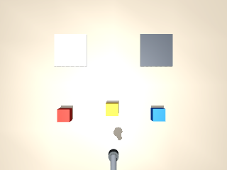
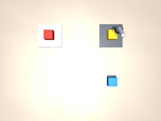

# HarnessMM-R

Generate instruction-conditioned pick-and-place demonstrations in MuJoCo. Each scene has three colored blocks and two landing pads. The agent must select the two requested blocks, pick each one up and release it on the assigned pad. The scene, camera and tool geometry are included.

| Initial observation | After the two placements |
| --- | --- |
|  |  |

The [example episode](example/train_000000/) contains five RGB frames, four high-level actions and 232 control ticks. The default expert runs entirely on a CPU. A second author uses a locally served Qwen3.8-27B vision model. Both use simulator-provided object poses and contact labels. Qwen also receives the overhead image.

## Run the offline expert

From the repository root, on Linux with Python 3.11:

```sh
cd harnessMM-R
python3.11 -m venv .venv
. .venv/bin/activate
python -m pip install -r requirements.txt
# For headless CPU rendering on Debian or Ubuntu:
sudo apt-get install libosmesa6-dev
export MUJOCO_GL=osmesa
python generate.py --episodes 10 --seed 17 --out outputs/expert
```

The expert reads the current state, finds an unfilled goal and proposes a pick followed by a placement. After the pick, the harness checks that the tool holds the intended block and the destination pad is free. If the check passes, it executes the queued placement. Otherwise the author sees a fresh observation. The CPU path runs offline after installation and requires no model weights or API key.

## Use Qwen on an H200

In a GPU allocation, start a CUDA build of llama.cpp with vision support. The verified setup used build `b12534`, the `Qwen3.8-27B-UD-Q4_K_M.gguf` weights and matching `mmproj-F16.gguf` from revision `4af51b3542f775b0a8e4b310bfb3f17e01c306c9` of `unsloth/Qwen3.8-27B-GGUF`. Set `MODEL_DIR` to the directory containing those two files.

```sh
llama-server -m "$MODEL_DIR/Qwen3.8-27B-UD-Q4_K_M.gguf" \
  --mmproj "$MODEL_DIR/mmproj-F16.gguf" -ngl 99 --ctx-size 4096 \
  --parallel 1 --reasoning off --alias Qwen3.8-27B-Q4_K_M \
  --host 127.0.0.1 --port 8080
```

In another shell on the same host, with the Python environment active and `MUJOCO_GL=osmesa`:

```sh
python generate.py --policy qwen --port 8080 --episodes 10 --seed 17 \
  --split train --out outputs/qwen-train
```

Qwen receives the instruction, the current RGB image, the simulator state and feedback from the last action. It returns up to two actions from the pick/place vocabulary. Each model reply is saved alongside the episode. The generator uses a loopback connection to the model server. [llama.cpp server documentation](https://github.com/ggml-org/llama.cpp/blob/master/tools/server/README.md)

In a smoke test on the two training scenes for seed 17, the CPU expert and Qwen on a shared NVIDIA H200 each completed both scenes. Each episode used two authored plans and four actions.

## Read a trajectory

Each episode directory contains:

| File | Contents |
| --- | --- |
| `task.json` | Language instruction, block-to-pad assignments, scene seed and split. |
| `steps.jsonl` | One row per attempted high-level action, with before/after observations, RGB paths, the authored plan or reused action, execution feedback, reward and termination flags. |
| `control.jsonl` | One row per executed 20 ms tick. Each row gives the Cartesian tool target in meters, active suction attachment and measured positions of the red, blue and yellow blocks, in that order. |
| `000.png`, `001.png`, … | 320 × 240 overhead RGB at reset and after each high-level action. |
| `result.json` | Outcome, decision count, action count, control ticks and final frame. |

Read `control_start` and `control_count` in a step row to find its zero-based slice in `control.jsonl`. RGB is sampled at decision and action boundaries. Control runs at 50 Hz and physics at 500 Hz. The tool is a Cartesian suction end effector with a switchable rigid attachment. After release, MuJoCo integrates gravity and contacts. A goal earns a terminal reward of one when both blocks are released, settled, touching the correct pads and within 24 mm of their centers on both horizontal axes.

The run-level `manifest.json` records the full scene population, selected split, source hashes and simulator version. `--episodes` sets the population size before `--split` filters it. Scenes are assigned 20% to training, 20% to validation and 60% to testing, using largest-remainder rounding with ties in that order. Scene seeds combine the run seed, split index and within-split index, so increasing the population preserves existing scenes in their original splits.

Use a fresh output directory for each run. `summary.json` counts all recorded outcomes, including the step limit. A model connection or reply error records `policy_error.json` and ends the run with a nonzero exit code. The remaining scheduled scenes can be identified from the manifest.
