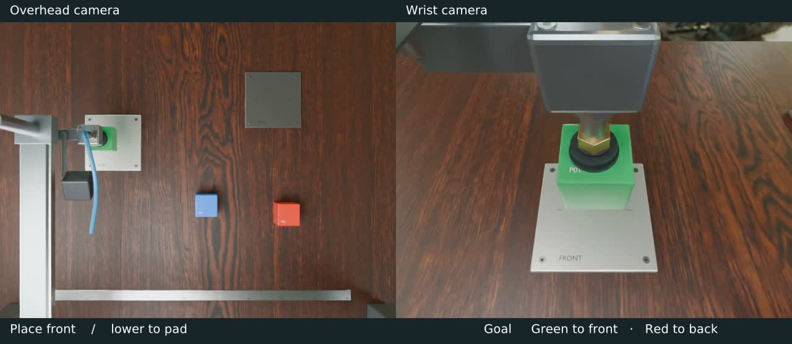

# Synchronized overhead and wrist demonstrations

[Watch a successful refill in Blender](train_000000/blender/preview.mp4) · [Download all episodes](episodes.zip) · [Download all Cycles action-boundary images](cycles-boundaries.zip) · [Episode index](index.jsonl)

[](train_000000/blender/preview.mp4)

Qwen3.8-27B received two live images at each planning call on a shared NVIDIA H200. The overhead camera is fixed in world coordinates. The second camera travels with the vacuum tool, looking down toward the pickup point. Both RGB images, measured object and tool poses, and camera extrinsics share a simulation timestamp. Model replies, proposed actions and guarded continuations are retained.

| Scene | Collected | Successful |
| --- | ---: | ---: |
| Clear and refill an occupied pad | 10 | 10 |
| Two-pad sorting | 10 | 9 |
| Three-pad sorting | 10 | 9 |

The batch contains 4,554 synchronized frame pairs, 157 high-level tool calls and 9,048 control ticks across all 30 episodes. Two episodes reached the 12-action limit. The population uses seed 20261124, six training, six validation and eighteen test scenes. This is a separate collection from the [single-camera planning comparison](../qwen-clear-refill/).

## Choose a representation

| Product | Coverage and format |
| --- | --- |
| Native simulator videos | All 30 episodes, both cameras, 320 × 240, 25 fps. Each planning image is also available as a lossless PNG. |
| Blender training images | All 30 episodes, both cameras at reset and each distinct action boundary, 480 × 360, 24 Cycles samples. The 186 timestamp pairs give 372 JPEGs. |
| Blender video example | One successful refill, both cameras at every recorded frame, 640 × 480 per view, 32 Cycles samples, 117 frames per camera at 25 fps. Separate streams and a labeled side-by-side preview are included. |

MuJoCo supplied the images used for model decisions. Blender 5.0.1 rendered the fixed camera and body poses afterward using the supplied workshop lighting, wood scans and workcell geometry. Each episode contains the inputs for rendering its full sequence at a chosen resolution. [Renderer and commands](../../rendering/README.md)

## Read an annotated action

In the [example](train_000000/), the green block initially occupies the back pad. The agent picks green, places it on the front pad, picks red and places red on the cleared back pad. The first call is `pick(block="green")` and covers zero-based control rows 0 through 57. At 0.20 s the tool is empty; at 1.36 s it holds green. Camera frames 0 and 29 show the two boundary states. The 50 Hz records label the approach, descent and lift between them. [Tool calls](train_000000/tool_calls.jsonl) · [Control](train_000000/control.jsonl) · [Frame poses and camera transforms](train_000000/poses.jsonl)

Unzip the two archives into separate directories. For an episode at `row["path"]` in the index, look up a boundary image at `KEYFRAMES / row["path"] / view / f"{frame:05d}.jpg"`. Both archives use the same episode paths. Frame indices are independent of rendering resolution. If an action was rejected without motion, its before/after indices refer to the same pair.

To check the frame counts, camera attachments, poses, annotations and image mappings, run:

```sh
python validate_views.py /path/to/extracted/episodes --keyframes /path/to/extracted/keyframes
```

The three workers used the [multi-scene batch command](../../README.md#generate-a-multi-scene-batch) with `--seed 20261124 --scenes clear-and-refill sort-two sort-three --episodes 30 --max-steps 12`. Each ran one of three shards against the same Qwen3.8-27B Q4_K_M vision server with three slots and a 12,288-token context. Each shard manifest records its effective configuration and source hashes.
